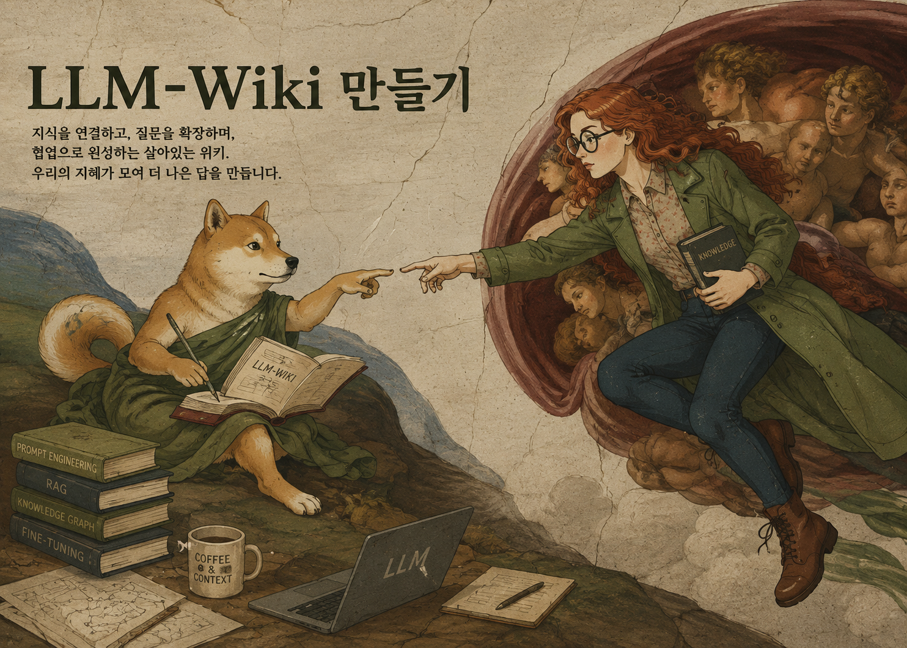

# LLM-Wiki: 지식이 축적되는 AI 작업 환경 만들기

**저자**: [안준용 (Joon-Yong An), 고려대학교](https://joonanlab.github.io/team)

*Last Update: 2026년 8월 5일*

  

## 들어가며

챗지피티와 대화하면서 몰랐던 것을 배우고, 얻은 답을 공부나 일에 써먹는다. 궁금한 것이 생길 때마다 묻다 보면 대화 기록은 제법 쌓인다. 나중에 필요한 내용을 찾으려면 그중 어느 대화에 있었는지부터 떠올려야 하는데, 분명 도움이 되었던 답도 다시 찾으려면 한참 걸릴 때가 있다. 서로 다른 대화에서 알게 된 내용이 어떻게 이어지는지 정리하는 일도 사용자의 몫이다.

이 책에서는 AI와 대화하며 얻은 지식을 정리해 두고 연구에 이어서 활용하는 LLM-Wiki 방식을 소개한다. LLM-Wiki는 폴더와 Markdown 문서로 만드는 지속적인 작업 기억이다. 한 주제로 여러 차례 대화했다면 그때마다 얻은 답을 한 문서에서 이어 볼 수 있도록 정리한다. 새 자료를 읽다가 앞서 적어 둔 설명을 고쳐야 할 때는 해당 문서로 돌아가 내용을 바꾼다. 사람이 무엇을 남기고 어떤 기준으로 정리할지 정하면, AI 에이전트가 그 규칙에 따라 문서를 만들고 갱신하는 일을 맡는다. 다음에 같은 주제로 질문할 때는 그 문서를 함께 읽으며 어디까지 알아보았는지 확인할 수 있다.

## 이 책의 구성

이 책은 세 부분으로 나누어 내용을 소개한다.

파트 1은 코딩 경험이 없어도 읽을 수 있고 대상은 연구자를 넘어 학생, 교사, 기획자, 행정 담당자, 창작자처럼 파일과 지식을 다루는 사람 전부다. 열네 장을 마치면 도구를 고르고 권한을 정하고 자신의 관심사에 맞는 위키를 만들고 자료 한 건을 끝까지 넣고 이미 가지고 있는 논문을 한 번에 들이고 보충 자료의 표를 분석에 쓰고 질문에 근거로 답하고 그 답을 다시 위키에 되돌릴 수 있다.

파트 2는 연구를 시작한 학생을 위한 과정이다. 이 도구가 무엇을 대신해 주지 않는지를 먼저 짚고 논문 한 편을 분야의 역사와 현재 논쟁 속에서 읽는 법에서 출발해, 남의 방법을 자기 설계로 바꾸고 다른 사람과 판단을 맞추고 자신의 근거로 과학적 주장을 쓰는 데까지 간다.

파트 3은 여러 사람과 프로젝트를 동시에 책임지는 연구책임자를 위한 것으로, 학생 지도, 공동연구, 그랜트 생애주기, 예약 자동화, 행정 서류 처리를 하나의 운영 기억으로 잇는다.

## 읽는 방법

아마도 이 책을 접하는 사람들은 주로 학생, 연구원, 교수들 일거라 예상한다. 우선 파트 1은 모든 독자들이 읽어야 한다. 각 챕터를 순서대로 읽는다. 기본적인 배경설명을 시작으로, 에이전트 설치, LLM-Wiki 구축, 활용 방법을 정리했다.

파트2는 학생 (대학원생, 학부생) 및 연수 연구원들을 위해 만들었다. 논문을 왜 쓰는지부터, LLM-Wiki를 논문 작성이나 분석에 어떻게 활용하는지, 그리고 처음 연구를 배우는 학생들이 온보딩 할 때 내가 사용하는 방법을 적어두었다.

파트3은 연구책임자들을 위해 작성했다. 실제로 내가 평소에 쓰던 방식 - 수많은 잡일과 행정적인 부담으로부터 나를 해방시켜준 일종의 해방일지와 같다. 생존 가이드라인이다. 이렇게 일하다 죽을순 없으니까.. 에이전트와 LLM-Wiki가 어떻게 연구책임자의 일을 덜어주는지를 정리했다.

## 장별 구성

| 장 | 제목 | 다루는 것 |
|---:|---|---|
| | 파트 1. 누구나 시작하는 LLM-Wiki | |
| 1 | LLM-Wiki란 무엇인가 | 대화가 남지 않는 이유와 다섯 층의 구조 |
| 2 | AI 에이전트와 작업 폴더 | 챗봇과 에이전트의 차이, 도구 고르기와 설치, 지침 파일 |
| 3 | Karpathy의 제안에서 나의 연구 위키까지 | 세 층 원형과 네 층 확장, 설치와 카테고리 설계 |
| 4 | 논문 한 편을 LLM-Wiki에 넣는 법 | ingest 여섯 단계와 종합 층 연결 |
| 5 | 논문 PDF를 ingest 하는 방법 | 추출기 선택과 조용히 발생하는 실패 |
| 6 | 논문 PDF 여러 개를 ingest하기 | 배치 절차, 제외 검사, 분모와 분자 보고 |
| 7 | 논문 PDF를 확보하는 방법 | 서지 정보 수집, 예약 후보 목록, paywall 앞의 절차 |
| 8 | Supplementary Table과 Document를 ingest 하는 방법 | 자원 층, manifest, 표를 분석 입력으로 쓰기 |
| 9 | 질문이 지식으로 축적되는 법 | 검색과 종합, 답을 위키로 되돌리기 |
| 10 | 논문의 구조를 해부하기 | 인용의 기능 분류와 신뢰 전략 비교 |
| 11 | 위키에서 연구 산출물로 | 아젠다, 발표, 원고로 나가는 경로 |
| 12 | Obsidian으로 보기와 채팅으로 묻기 | 그래프가 보여 주는 것과 대화로 지식을 내재화하기 |
| 13 | 에이전트에게 주는 권한의 경계 | Codex와 Claude Code의 권한 모드, 되돌릴 수 있는가라는 기준 |
| 14 | 말로 지시하고 맥락을 넘기는 법 | 긴 수다 세션, 작업 공간별 라우팅 |
| | 파트 2. 연구를 시작하는 학생의 LLM-Wiki | |
| 15 | 논문이란 무엇인가 | 분야의 대화에 들어가기, field map |
| 16 | 상용 AI에 넣으면 안 되는 자료 | 자료 경계, 폐쇄망 위키, 로컬 모델 |
| 17 | 데이터 분석을 위한 폴더 구성 | 분석 프로젝트 폴더, method page와 연구 설계 |
| 18 | 공동 연구 미팅을 준비하는 법 | 사전 자료, 결정 기록, 회의 전사와 노트 |
| 19 | 논문 원고 폴더 구성하기 | 논문 폴더, claim-evidence 지도와 원고 구성 |
| 20 | 새로운 주제 온보딩 하기 | 고른 논문 건네기, 잘라 낼 때의 링크, 돌아오는 경로 |
| 21 | 에이전트가 대신해 주지 않는 것, 당신의 과학 | 요약과 앎의 거리, 말하기와 글쓰기 훈련, 과학적 책임 |
| | 파트 3. 연구책임자의 LLM-Wiki | |
| 22 | MCP 기본 개념 | 메일, 달력, 팀 대화, 팀 문서, HWP 양식 |
| 23 | 도반, 당신의 공동연구자를 지도하는 법 | 사람별 기록과 개입의 승격 |
| 24 | Meetings 폴더로 PI의 외부 활동 관리하기 | 세미나, 자문, 미팅, 출장과 반복 업무 |
| 25 | Notion MCP로 연구실 프로젝트 관리하기 | 앵커 규약, 공유 계층과 지식 저장소 |
| 26 | LLM-Wiki와 에이전트를 이용하여 연구과제 관리하기 | 여섯 국면과 Aim별 근거 표 |
| 27 | AI 비서와 예약 자동화 만들기 | 스케줄러의 종류, 모듈 분리, 권한 경계와 운영 계약 |
| 28 | 브리핑과 채널로 결과를 받는 법 | 아침 브리핑과 연구 브리핑, 채널을 나누는 기준 |
| 29 | 행정 서류를 안전하게 처리하는 법 | HWP 양식, 서명 배치, 멈추는 조건 |
| 30 | 원격으로 에이전트를 관리하기 | 24시간 호스트, Codex Remote, 음성 지시와 원격 승인 |

## 이 책이 약속하지 않는 것 - 오롯한 당신의 몫

AI 에이전트에게 수백 편의 논문에서 필요한 근거를 찾아달라고 할 수 있다. 관련된 결과를 한데 모아 놓으면 어떤 설명들이 나와 있는지 살펴보기 수월해지고, 그 가운데 결론이 엇갈리는 논문도 눈에 들어온다. 연구 대상이 달라서 결과가 어긋난 것이라면 그 차이를 밝혀 적는 것으로 두 논문의 관계를 다시 설명할 수 있다. 조건이 비슷한데도 결과가 다르다면 어느 근거를 더 믿을지 쉽게 결정하기 어렵다. 논문을 더 읽으면 판단이 설 때도 있겠지만, 지금 가진 근거로는 결론을 미뤄야 할 수도 있다. 무엇을 알아보려는 연구인지에 따라 필요한 근거도, 그 근거로 말할 수 있는 범위도 달라진다. 문제를 고르고 근거를 가려 자신의 주장을 세우는 일에는 이런 판단이 거듭 들어가며, 연구자는 그 판단을 과학 공동체 앞에서 검증받는다. 과학적 지식 생산의 주체성(epistemic agency)은 그 과정을 스스로 해나가는 데 있다.

작가 김겨울은 『책의 말들』(유유, 2021)에서 어려운 책이 이해되기 시작하는 순간을 이렇게 쓴다. “이해가 가지 않던 책이 조금씩 조금씩 이해의 범위 안으로 들어올 때면 찰칵, 하는 소리가 들려온다. 퍼즐이 맞춰지는 소리, 혹은 열쇠로 문을 여는 소리. 이 소리가 내 방의 문을 잠그는 소리가 될까 봐 서둘러 다른 책들을 책상 언저리에 쌓는다.” 위키에 정리된 설명도 자꾸 읽으면 익숙해져서, 새 논문을 읽을 때 그 설명에 들어맞는 결과부터 눈에 들어올 수 있다. 결과를 옮겨 적을 때도 익숙한 설명을 뒷받침하는 데만 관심을 두면, 어느 대상에서 어떤 조건으로 얻은 결과인지 빠뜨릴 수 있다. 나중에 다른 대상을 연구하면서 그 문장을 다시 읽으면, 처음의 조건이 사라진 설명을 근거로 삼을 수 있다. 원문으로 돌아가 연구 대상을 확인하면 위키의 설명에서 빠뜨렸던 조건을 다시 적을 수 있다. 그 조건이 내가 연구하려는 대상에서도 성립하는지는 아직 따로 알아보아야 한다.
